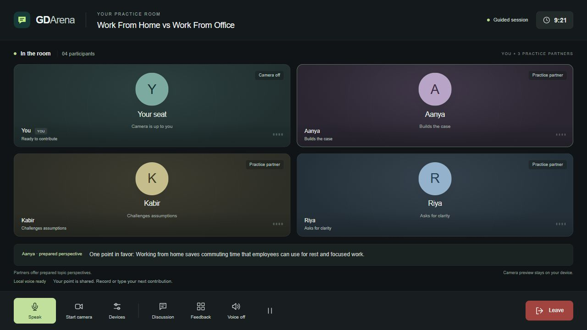
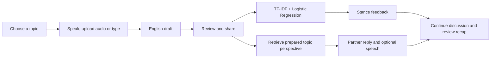

# GD Arena

**ML-based group discussion practice with voice input and a meeting-style interface.**

DEPLOYED LINK - https://gd-arena-ml-3ek8.onrender.com/

Choose a topic, share your perspective, and practise with three virtual partners. A trained stance classifier analyses whether your point supports, opposes, or stays neutral toward the selected topic proposition.



## Features

- **10 interview-style topics**, including AI and jobs, remote work, online education, skills vs degrees, and digital payments.
- **Three virtual practice partners:** Aanya builds the case, Kabir challenges assumptions, and Riya asks for clarity.
- **Voice or text input**, with microphone selection, an input-level meter and audio upload.
- **Automatic pause detection:** recording ends after 1.5 seconds of silence following speech. Eligible English points can be shared automatically.
- **Automatic speaking turns:** after an English voice contribution, Aanya, Kabir and Riya speak one at a time, then the microphone reopens for the user. Pause, Stop playback, leaving the tab or disabling Automatic speaking turns cancels the flow. Hindi/Hinglish still requires English review.
- **Optional webcam:** starts off and shows an avatar until the user enables it. Camera preview stays on the device.
- **English, Hindi and Hinglish speech transcription.** Hindi/Hinglish requires a manually reviewed English version before stance analysis.
- **Session timer, spoken replies, feedback, recap and transcript download.**
- **Ready-trained model, training code, Colab notebooks and a seven-slide presentation included.**

## Quick start

The project was tested with **Python 3.12**. Retraining is not required.

```bash
git clone https://github.com/codewithshlok334/gd-arena-ml.git
cd gd-arena-ml
python launch.py
```

The launcher installs missing dependencies, downloads the pretrained speech model on first setup, and opens **http://127.0.0.1:7860/**. Keep the terminal running during the demo. Internet is required for initial setup; no paid API key is needed. If voice setup cannot finish, text practice remains available.

On Windows, you can also run `START_GD_ARENA.cmd`. In VS Code, open this repository folder or `GD_Arena.code-workspace`.

### Virtual environment setup

Windows PowerShell:

```powershell
py -3.12 -m venv .venv
.\.venv\Scripts\python.exe -m pip install -r requirements.txt
.\.venv\Scripts\python.exe setup_voice.py
.\.venv\Scripts\python.exe launch.py
```

macOS/Linux:

```bash
python3 -m venv .venv
.venv/bin/python -m pip install -r requirements.txt
.venv/bin/python setup_voice.py
.venv/bin/python launch.py
```

Select the project environment in VS Code using **Python: Select Interpreter**. See [the setup guide](VS_CODE_START_HERE.txt) for debugging, retraining and troubleshooting.

## Deploy on Render

[Deploy GD Arena on Render](https://render.com/deploy?repo=https://github.com/codewithshlok334/gd-arena-ml)

Open the link while signed in to Render, review the `gd-arena-ml` service on the **Free** plan, and choose **Deploy Blueprint**. The included `render.yaml` configures Python 3.12, installs dependencies, downloads the pinned Whisper tiny model during the build, and starts the app on Render's assigned port. Retraining and API keys are not required.

Once the service is **Live**, open the HTTPS URL shown in its dashboard. Choose a topic, allow microphone access, select your laptop/headset microphone, and press **Speak**. Camera access is optional. Audio is sent to your Render service for transcription and is not saved; camera video stays in the browser.

Render's Free instance sleeps after 15 minutes without traffic and can take about a minute to wake. Its limited CPU and 512 MB memory make this a small demo deployment: use short voice turns, one speaker at a time, and allow extra time for transcription. Actual voice latency and memory use need checking after deployment. If Render reports out-of-memory errors, review a larger plan before upgrading; this Blueprint never selects paid compute.

Later pushes to `main` trigger deployments automatically. Local edits must still be committed and pushed to GitHub first. See [Render's Free limits](https://render.com/docs/free) and [Blueprint documentation](https://render.com/docs/blueprint-spec).

For manual **New → Web Service** setup, use Python, branch `main`, build command `pip install -r requirements.txt && python setup_voice.py`, start command `python app.py --host 0.0.0.0 --port $PORT`, health check `/api/health`, and the Free instance. The repository's `.python-version` selects Python 3.12. Apply the environment variables from `render.yaml` as well.

## How it works



Audio is transcribed with **pretrained Whisper tiny through faster-whisper** before entering the text workflow. The project trains the **stance classifier**. Partner replies are retrieved from authored training examples using topic, role and text relevance; they are not generated by an LLM.

English voice input uses a single decoding pass without timestamp prediction to reduce waiting. Hindi/Hinglish retains its existing decoding settings. Speech detection and silent-recording checks remain enabled. Browser playback prefers installed voices when available, avoiding remote voice startup delays. Transcription accuracy and speed still depend on the recording and server load.

## Technology stack

| Layer | Technology |
| --- | --- |
| Frontend | HTML, CSS, vanilla JavaScript |
| Backend | Python, standard-library `ThreadingHTTPServer`, JSON endpoints |
| Machine learning | scikit-learn, TF-IDF, one-vs-rest Logistic Regression |
| Data and persistence | NumPy, SciPy, CSV, joblib |
| Speech recognition | faster-whisper, pretrained multilingual Whisper tiny |
| Browser media | MediaRecorder, Web Audio, speechSynthesis, getUserMedia |
| Development and training | VS Code, Google Colab, Matplotlib |

## Training and evaluation

The selected model is trained on **11,484 examples**: 11,304 cleaned public VAST examples and 180 authored GD examples. The complete authored dataset contains 300 English examples, split into 180 training, 60 validation and 60 test examples.

The feature pipeline combines word and character TF-IDF with topic-conditioned features. Features are fitted only on training data. Logistic Regression and Linear SVM are compared against a majority baseline; selection uses mean macro-F1 across the two validation sets.

| Held-out test set | Examples | Accuracy | Macro-F1 |
| --- | ---: | ---: | ---: |
| Cleaned public VAST | 2,907 | 43.31% | 0.3868 |
| Authored GD examples | 60 | 63.33% | 0.6376 |

The GD examples are assistant-authored synthetic educational data, not an independently labelled real-user benchmark. The cleaned VAST evaluation is not a direct reproduction of the original paper's benchmark. Stance prediction is imperfect and does not measure interview quality, speaking confidence or grammar. Decision scores are not calibrated probabilities.

See [full results](RESULTS.txt), [machine-readable metrics](artifacts/metrics.json) and [data provenance](DATA_SOURCES.txt).

### Repeat training

Use the configured environment to run:

```bash
python gd_model.py train --output-dir artifacts_retrained
```

This downloads and checks the pinned public dataset, then writes a separate model and evaluation reports. The app continues using the included `artifacts/stance_model.joblib`.

## Colab and presentation

- [Training notebook](notebooks/GD_Arena_Colab.ipynb) · [Open in Colab](https://colab.research.google.com/github/codewithshlok334/gd-arena-ml/blob/main/notebooks/GD_Arena_Colab.ipynb)
- [Ready-demo notebook](notebooks/GD_Arena_Run_Demo_Colab.ipynb) · [Open in Colab](https://colab.research.google.com/github/codewithshlok334/gd-arena-ml/blob/main/notebooks/GD_Arena_Run_Demo_Colab.ipynb)
- [Seven-slide PowerPoint](docs/GD_Arena_Presentation.pptx) — English slides and speaker notes; editable presenter details.
- [Demo talking points](DEMO_TALK_TRACK.txt)

## Project structure

```text
gd-arena-ml/
├── app.py                  # Web server, model API and partner replies
├── gd_model.py             # Dataset preparation, training and prediction
├── speech.py               # Audio validation and transcription
├── launch.py               # Setup and run the ready model
├── setup_voice.py          # Download pinned pretrained speech weights
├── build_web_assets.py     # Rebuild bundled frontend assets after edits
├── topics.json             # Ten topics and their target propositions
├── web/                    # Meeting interface, microphone and camera controls
├── data/gd_examples.csv    # Authored examples with fixed data splits
├── artifacts/              # Trained stance model, metrics and evaluation plots
├── notebooks/              # Training and ready-demo Colab notebooks
├── tests/                  # Model, API, speech and frontend checks
└── docs/                   # Presentation and app screenshot
```

## Checks

With the project dependencies installed:

```bash
python -m unittest discover -s tests -v
```

Optional JavaScript checks require Node.js:

```bash
node tests/test_voice.cjs
node tests/test_mic_errors.cjs
node tests/test_camera.cjs
node tests/test_frontend_bundle.cjs
node tests/test_auto_round.cjs
node tests/test_speech_playback.cjs
```

## Microphone and webcam

Open the local app in Chrome or Edge, allow microphone access, and select an active laptop or headset microphone. Check the input-level meter before speaking. If no signal appears, check Windows input volume and the microphone's mute switch. Audio upload and typed input are also available.

The browser sends recordings to the Python server for transcription; the app does not save the recordings. With the local demo, processing stays on the laptop. With Colab, audio is sent to that Colab runtime. Webcam frames remain a local preview and are not sent to the server.

## Sources and scope

- VAST: Allaway and McKeown (2020), [paper](https://aclanthology.org/2020.emnlp-main.717/) and [author repository](https://github.com/emilyallaway/zero-shot-stance).
- Speech: [faster-whisper](https://github.com/SYSTRAN/faster-whisper) and [pretrained tiny model](https://huggingface.co/Systran/faster-whisper-tiny).
- Presentation photo: [Monstera Production / Pexels](https://www.pexels.com/photo/diverse-students-discussing-project-at-table-6238033/).

Raw VAST comments, third-party speech weights, local environments, recordings and caches are excluded from this repository. Third-party datasets and models retain their original terms; this repository does not assign a new license to them. Detailed provenance is in [DATA_SOURCES.txt](DATA_SOURCES.txt).

Future work includes independently labelled user data, stronger contextual classifiers and improved multilingual stance analysis.
